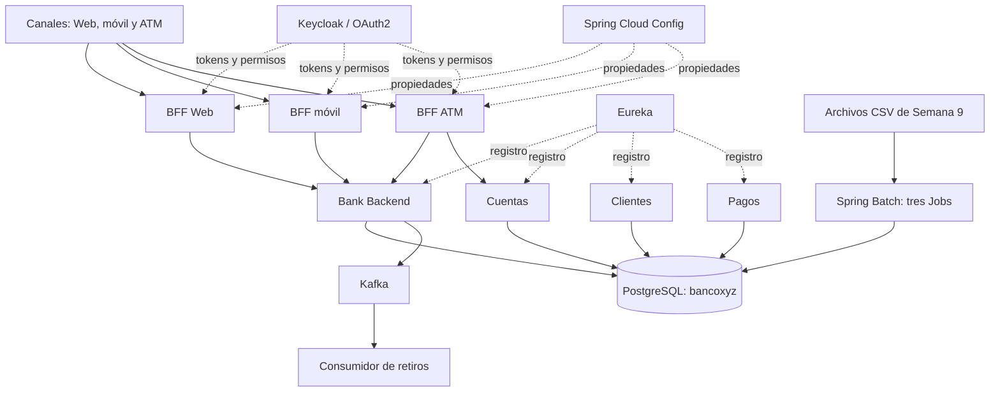

# Propuesta técnica de modernización para BancoXYZ

**Asignatura:** Desarrollo Backend III (PBY2203), Semana 9 - Evaluacion Final Transversal
**Responsable de esta versión:** Egor Llancapichun  
**Repositorio de destino:** [Egor-ll/Exp3_ETF_BackendIII](https://github.com/Egor-ll/Exp3_ETF_BackendIII)

## 1. Síntesis

BancoXYZ necesita reducir la dependencia de un sistema bancario centralizado y facilitar la evolución de sus canales digitales. Esta propuesta organiza el trabajo en tres frentes: sustituir procesos batch legacy por Jobs de Spring Batch, separar los contratos para Web, móvil y cajeros, y dividir capacidades de negocio en servicios con controles de seguridad y comunicación asíncrona.

El repositorio entregado contiene una solución de laboratorio basada en Spring Boot y Docker Compose. La topología incluye PostgreSQL, Keycloak, Eureka, Config Server, servicios de negocio, BFF y brokers Kafka. La arquitectura permite demostrar separación de responsabilidades y operación local; por sí sola no certifica disponibilidad, seguridad ni rendimiento de producción en AWS.

## 2. Necesidades del negocio

| Necesidad | Resultado que se busca | Decisión de diseño |
|---|---|---|
| Procesar volúmenes periódicos de información | Repetir ejecuciones sin corromper los resultados | Jobs independientes de Spring Batch, procesamiento por pasos y control de reejecución |
| Atender canales con requisitos distintos | Evitar enviar a todos los clientes una respuesta genérica | Un BFF para Web, uno para móvil y otro para ATM |
| Reducir el impacto de fallos y cambios | Aislar dominios y dependencias externas | Servicios separados, descubrimiento, configuración central y Resilience4j |
| Proteger operaciones y datos | Autorizar solicitudes por identidad y canal | OAuth2/JWT con Keycloak y validación de permisos en Spring Security |
| Desacoplar notificaciones de la operación principal | Consumir eventos sin bloquear la respuesta del canal | Publicación y consumo de eventos mediante Kafka |

Las decisiones se ajustan a un entorno académico que puede ejecutarse en una sola máquina. Se prioriza la reproducibilidad y la evidencia funcional, con una ruta clara para separar bases de datos y desplegar en múltiples hosts en una etapa posterior.

## 3. Vista de arquitectura

La configuración de Docker Compose define 16 servicios para el entorno local. Caddy se agrega mediante el perfil `ec2`. El ejecutable de Spring Batch se lanza aparte: comparte PostgreSQL con el resto de la solución, pero no queda como contenedor residente del Compose.

## 4. Procesamiento de datos

Los procesos se modelan como Jobs con lectura, transformación, validación y escritura. Spring Batch registra ejecuciones y facilita diagnosticar fallos y reanudar el trabajo según la configuración de cada paso.

| Proceso | Job | Consideración de concurrencia |
|---|---|---|
| Resumen de transacciones | `transaccionJob` | Paralelismo configurado con tres hilos |
| Cálculo de intereses | `cuentaInteresJob` | Secuencial para evitar actualizaciones concurrentes inseguras sobre la misma cuenta |
| Estado anual | `estadoCuentaAnualJob` | Paralelismo configurado con tres hilos |

Los archivos CSV proporcionados para Semana 9 son fuentes de entrada y deben permanecer sin modificaciones. La carga debe preservar consistencia y permitir comparar los resultados con las salidas anteriores.

La documentación entregada registra las ejecuciones `34`, `35` y `36` como `COMPLETED`. También informa que, tras repetir los Jobs, se conservaron conteos y huellas de contenido en las tablas de resultados. Son evidencias reportadas por el proyecto; deben acompañarse con capturas o una nueva ejecución reproducible al presentar la entrega.

## 5. Servicios y contratos por canal

### BFF

- **Web:** devuelve información más completa para pantallas de consulta con mayor espacio y capacidad de interacción.
- **Móvil:** reduce el tamaño de las respuestas y prioriza datos esenciales.
- **ATM:** ofrece operaciones acotadas de consulta y retiro con autorización específica.

La separación permite modificar una interfaz sin imponer el mismo contrato a las otras. Cada BFF usa su propio cliente OAuth2 y permisos asociados al canal.

### Servicios de negocio

| Servicio | Alcance del laboratorio |
|---|---|
| Cuentas | Operaciones de administración de cuentas de gestión |
| Clientes | Administración de perfiles de clientes |
| Pagos | Pagos, transferencias y depósitos persistidos en PostgreSQL |
| Bank Backend | Funcionalidad bancaria existente, incluyendo consultas y retiros legacy |

El servicio de Pagos y los retiros legacy operan sobre conjuntos de tablas distintos. Por ello, la implementación no debe describirse como un libro mayor único ni como procesamiento de pagos bancarios reales.

## 6. Seguridad, resiliencia y eventos

### Identidad y autorización

Keycloak emite tokens OAuth2/JWT. Los BFF y servicios verifican tokens con Spring Security y aplican permisos por canal. La evidencia local descrita en el repositorio incluye respuestas `401` para solicitudes sin autenticación válida y `403` cuando el token no cumple el permiso requerido.

Los certificados PKCS12 incluidos corresponden al entorno de laboratorio. Para un endpoint público se necesita un dominio, certificados de confianza pública y validación HTTPS desde fuera de la instancia.

### Tolerancia a fallos

Resilience4j configura Circuit Breaker, Retry y Rate Limiter para acotar la presión sobre dependencias. Los reintentos deben reservarse para operaciones que puedan repetirse sin duplicar efectos. Para operaciones monetarias se usa una clave de idempotencia; la documentación reporta que una clave repetida con el mismo cuerpo conserva el resultado, y una clave reutilizada con un cuerpo distinto devuelve `409`.

### Flujo de eventos

El backend publica eventos de retiro hacia Kafka y un consumidor independiente los recibe. El envío está asociado a la confirmación de la transacción en PostgreSQL para evitar publicar un retiro que luego se revierta. Esta estrategia no constituye una transacción distribuida entre PostgreSQL y Kafka; para garantizar entrega ante fallos en esa frontera se necesitaría implementar y probar un patrón adicional, como outbox.

La topología de laboratorio define tres brokers y un topic de retiros con tres particiones, factor de replicación tres y `min.insync.replicas=2`. Esos valores en un Compose de un solo host no equivalen a tolerancia a la caída de una zona de AWS.

## 7. Datos y despliegue

PostgreSQL 17 contiene los datos operacionales y los metadatos de Spring Batch. En esta etapa, los servicios de negocio comparten una instancia y una base llamada `bancoxyz`. Esto simplifica la instalación, aunque deja pendiente aislar propiedad de datos por dominio.

Docker Compose integra las aplicaciones y dependencias del laboratorio. Los servicios de Cuentas, Clientes y Pagos están configurados para aceptar réplicas; el escalamiento local debe verificarse observando registros de Eureka y distribución de solicitudes antes de considerarlo validado.

El despliegue en EC2 depende de variables, un checkout actualizado, recursos de host, DNS y reglas del Security Group. La existencia de scripts de despliegue no prueba que esta versión esté operativa en AWS. La comprobación debe ejecutarse sobre el commit publicado e incluir salud de servicios, prueba externa de TLS y evidencia fechada.

### Configuración de secretos

Las contraseñas y secretos OAuth2 se suministran localmente mediante `.env` o un gestor de secretos. `.env` no debe agregarse a Git ni copiarse al paquete de entrega. Los certificados privados `.p12` también requieren una decisión explícita antes de publicarse; los certificados de laboratorio deben sustituirse por credenciales gestionadas y rotables en un entorno público.

## 8. Estado de la solución y límites

| Área | Estado que figura en la documentación del proyecto | Qué falta para una afirmación de producción |
|---|---|---|
| Jobs Batch | Tres Jobs con ejecuciones completadas e idempotencia reportada | Repetir la validación desde una instalación limpia y adjuntar resultados |
| BFF y seguridad | Tres canales y permisos JWT implementados; HTTPS local | Certificado público, revisión de configuración y pruebas externas |
| Servicios de negocio | Cuentas, Clientes y Pagos separados | Integración con un modelo de datos unificado y pruebas operacionales |
| Kafka | Cluster local KRaft con tres brokers y consumidor de retiros | Despliegue distribuido, TLS/SASL, monitoreo y estrategia de entrega garantizada |
| Compose | Configuración local y perfil `ec2` preparados | Validar capacidad, réplicas y recuperación en AWS |
| Entrega | README, instrucciones, despliegue y esta propuesta | Informe PDF usando la plantilla oficial y video MP4 de 5–7 minutos con webcam |

Esta tabla distingue implementación descrita, evidencia pendiente y objetivos futuros. La propuesta no atribuye a la nube resultados que aún no se han comprobado en AWS.

## 9. Plan de evolución

1. Completar la publicación del código sin secretos ni llaves privadas.
2. Ejecutar la configuración de Compose y los procesos Batch desde el repositorio publicado; guardar salidas y capturas.
3. Desplegar el mismo commit en EC2 y registrar DNS, HTTPS, salud de contenedores y pruebas externas.
4. Aislar secretos con un mecanismo de gestión de credenciales y rotar cualquier valor que haya sido reutilizado.
5. Diseñar propiedad de datos por servicio y una estrategia de consistencia para eventos, con outbox si se requiere entrega confiable.
6. Completar el informe PDF solicitado y grabar la presentación con evidencia del sistema y cámara.

## 10. Correspondencia con la pauta

| Criterio | Evidencia principal |
|---|---|
| Procesos de modernización | Sección 2 y tabla de componentes |
| Requerimientos de negocio | Sección 2 |
| Tres Jobs Batch | Sección 4 y código de `batch-service` |
| BFF para Web, móvil y ATM | Sección 5 |
| Microservicios, seguridad, resiliencia y Kafka | Secciones 5 y 6 |
| Docker, escalabilidad y nube | Sección 7 |
| Documentación | README, instrucciones, despliegue e informe PDF pendiente |
| Presentación | Video de 5–7 minutos pendiente de grabación |

## Procedencia

La responsable de esta versión y de la entrega es Egor Llancapichun. El paquete recibido contiene código e historial previos vinculados a [LadyRed145/bancoxyzbatch](https://github.com/LadyRed145/bancoxyzbatch), incluida una atribución a Natalia Alvarado. La evolución previa se mantiene identificable; las contribuciones de esta versión deben quedar en commits separados con su autor real.

